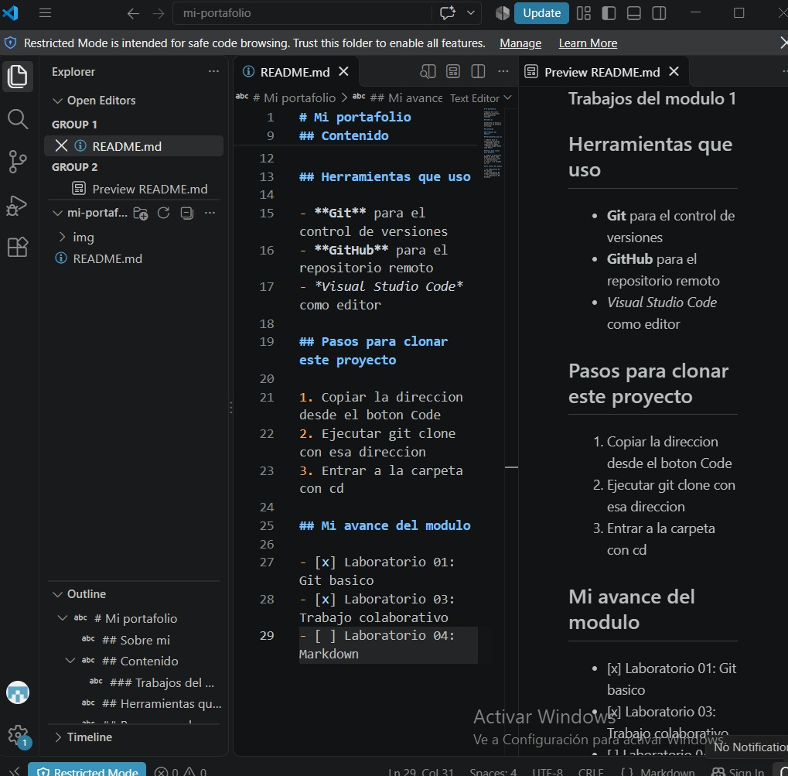

# Guia del Laboratorio 03: Trabajo colaborativo

Esta guia explica como trabajar de manera colaborativa utilizando Git y GitHub.

## Descripcion del proyecto

En este laboratorio se utilizaron herramientas de control de versiones para colaborar en un repositorio y proponer cambios mediante un Pull Request.

### Herramientas utilizadas

- **Git** para controlar las versiones.
- **GitHub** para compartir el repositorio.
- *Visual Studio Code* para editar los archivos.

## Pasos para realizar el proyecto

1. Ingresar al repositorio del docente en GitHub.
2. Crear una copia mediante Fork.
3. Clonar el repositorio en la computadora.
4. Abrir el proyecto en Visual Studio Code.
5. Realizar las modificaciones solicitadas.
6. Guardar los cambios con Git.
7. Subir los cambios al repositorio personal.
8. Crear un Pull Request hacia el repositorio del docente.

## Comandos utilizados

Para revisar los cambios del proyecto utilizamos `git status`.

```bash
git clone URL-DEL-REPOSITORIO
git status
git add .
git commit -m "Actualiza el proyecto"
git push origin main
```

### Descripcion de comandos

| Comando | Funcion |
|---------|---------|
| git clone | Descarga el repositorio |
| git status | Muestra los cambios |
| git add | Prepara los archivos |
| git commit | Guarda una version |
| git push | Publica los cambios |

## Lista de tareas

- [x] Crear el Fork del repositorio.
- [x] Clonar el proyecto.
- [x] Realizar modificaciones.
- [x] Crear el Pull Request.
- [ ] Revisar la aceptacion del Pull Request.

## Enlace de referencia

- [Documentacion oficial de GitHub](https://docs.github.com/es)

## Captura de mi entorno de trabajo



## Conclusion

Este laboratorio me permitio comprender como utilizar Git y GitHub para trabajar de manera colaborativa, organizar los cambios y compartir aportes mediante Pull Requests.